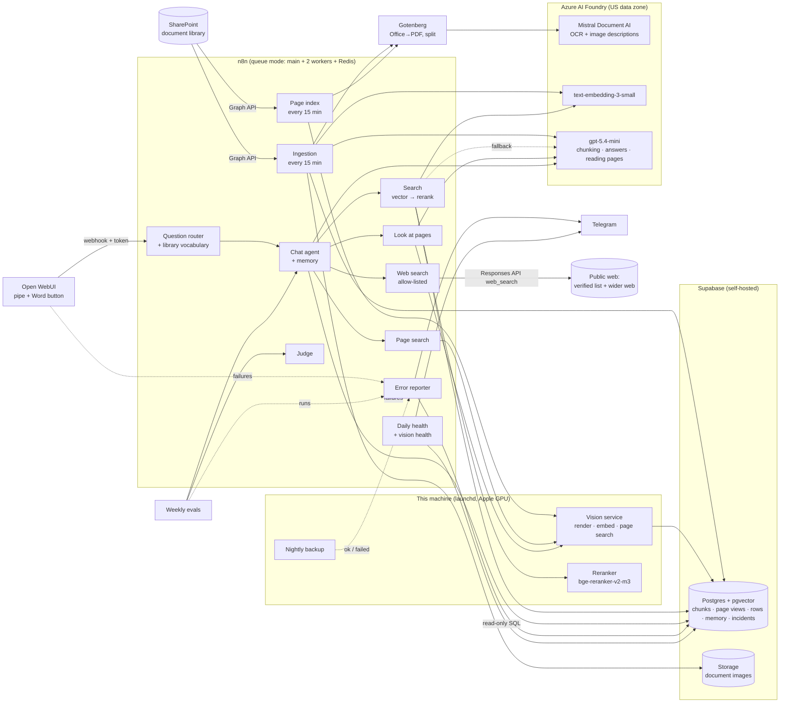

# Private RAG for SharePoint, built with n8n

A self-hosted "chat with your documents" assistant for a SharePoint document library.
Ask a question in a ChatGPT-style window; get an answer grounded in your own files, with the
source and page cited and, for how-to questions, the relevant screenshots from the documents shown under the right step.
It also finds and reads drawings, scanned pages and charts by looking at them.

- **Your data stays in your stack:** documents, vectors, page images, chats and images live in your own Postgres
  (Supabase) and on your own machine. Page images are embedded and search results reranked **locally** on the Mac's GPU;
  only the reading and answering calls leave, to Azure AI Foundry in a US data zone (no training on your data).
- **Keeps itself in sync:** every 15 minutes it compares SharePoint with what it has indexed and
  processes only what's new, changed, renamed or deleted.
- **Reads everything:** PDFs, Word, PowerPoint (incl. scanned pages, via OCR), images inside documents
  (described by the OCR model so screenshots are searchable), photos with no text (described by a vision
  model), and spreadsheets (every tab of .xlsx/.xlsm) queried with SQL, not guessed from text.
- **Finds and reads drawings, scans and charts:** every page is rendered and embedded (large sheets also as 12 tiles and
  a title-block crop), so a question about a plan sheet, detail, figure or chart finds the page by how it looks, by its
  sheet or figure number, or by keywords. A vision model then reads the actual page — the whole sheet plus its zoomed
  tiles, with a second zoom pass for values read off a chart — and only its short answer goes back to the agent. Chart
  readings are always labelled approximate.
- **Cites pages, not just files:** every text passage knows which pages it came from (matched against the page index;
  98.5% right on a phrase probe), so answers say "p. 14-16" for PDFs, Word and PowerPoint alike.
- **Reads messages the way people type them:** typos, clipped words ("Fall" for *outfall*) and swapped acronym letters
  are read against the library's own vocabulary. A change of meaning is announced in one line ("I read 'Fall' as
  **outfall**"), spelling fixes are silent, identifiers are never touched, and a named document that isn't in the
  library is reported as not found instead of being imitated.
- **Knows what's current — with three levels of trust:** when the documents don't cover it (current regulations,
  recent changes, best practices, products), it searches an **allow-list of authoritative public sites** and, when
  that isn't enough, the **wider web**. Answers keep three separate sections — **From your documents**, **From verified
  public sources**, **From the wider web — not on the verified list** — and the web sections are assembled by code
  from the sorted search results, so a source can never be relabelled. A **review mode** turns this into a gap
  report for any template, standard or checklist: what's covered, what to add, what may be outdated, with sources.
- **Answers you can use:** screenshots are moved under the step they illustrate, anything shaped like a password is
  hidden, and a **Download as Word** button turns an answer into a tidy .docx draft.
- **Checks itself:** every failure anywhere becomes one Telegram alert with a reference number, and the user sees a
  plain line with the same number instead of a raw error. The test sets run every week against floors, a nightly
  backup is validated before it counts, and the 08:00 digest reports incidents, eval scores and backup age.
- **Built for operations:** queue-mode n8n, overlap guard, per-file retry, a run time limit that cancels a
  frozen run, fallbacks for files the converter rejects, 90-day retention, a one-command right-to-erasure script, and
  usage counts that never store questions.

Based on the blueprint from the M365.FM podcast episode *"Building Private RAG: A Blueprint for SharePoint
& n8n"*, built end to end and hardened for real-world documents. Everything below is what actually runs.

## Architecture



### Ingestion (the `RAG – Ingestion` workflow)

| Step | What happens |
|---|---|
| ① Start & safety check | Runs every 15 min (set it to every 2 min by hand to clear a big backlog), 4 files per run; skips if another run is still going (asks n8n's own DB); 30-min time limit. |
| ② What's in SharePoint now | Lists the library through Microsoft Graph — the top level and every subfolder one level deep (folders named DNU / "Do Not Use" are skipped) — following `@odata.nextLink` pages. Files in a folder are named `Folder/File`. |
| ③ What changed | Compares against `document_metadata` using Graph's `quickXorHash` content fingerprint → new / updated / renamed-only / deleted / unchanged. Outdated files (`OLD_…`, "Do Not Use") count as absent. |
| ④ Batch & download | Takes 4 files, clears any half-finished data for them first (every run is idempotent). |
| ⑤ Spreadsheets → SQL | Rows from **every tab** (.xlsx/.xlsm; legacy .xls/.csv fall back to the first) go into `document_rows` as JSON (tab name in `_sheet`), so the agent can count and filter exactly. Zip archives of `.tbl` data tables are unzipped into rows the same way. |
| ⑥ Prepare for OCR | Gotenberg converts Office files to PDF and splits long PDFs into 10-page parts; a file it rejects goes to OCR whole. |
| ⑦ Read the pages | Mistral Document AI returns Markdown per page plus a description of every image. Photos with no text are described by gpt-5.4-mini instead. |
| ⑧ Images → Storage | Images are uploaded to Supabase Storage; links in the text point at them. |
| ⑨ Cut, embed, store | GPT proposes chunk boundaries over numbered paragraphs ("agentic chunking"); code validates and repairs the plan, merges tiny chunks, caps size. Chunks are embedded (1536-d) into pgvector. File metadata is written **last**, so a crash means "redo", never "half-indexed but marked done". |

### Visual page search (`RAG – Page index` + the local vision service)

Every 15 minutes *Page index* finds files whose pages aren't indexed yet (new, changed, or a failed attempt), downloads
them, converts Office files to PDF with Gotenberg and hands them to the **vision service** (`vision/`, FastAPI on
127.0.0.1). The service renders every page — and, for large drawing sheets, 12 overlapping tiles plus a title-block
crop — turns scans upright (Tesseract read in all four orientations, rotate only on a clear win), embeds each view with
**EmbeddingGemma 2** on the Mac's GPU, and stores it in `page_views` (halfvec + HNSW, plus the page's own text layer for
keywords). It keeps the original so zooms render at full resolution, prunes deleted files, and matches every text
passage to its pages (`page_start` / `page_end` / `page_best` in the passage metadata). Image embedding stays local
because no multimodal embedder on Azure is offered in a US-only deployment.

### Answering (the `RAG – Chat agent (vision)` workflow and its tools)

1. Open WebUI's **Knowledge Assistant** pipe forwards the newest message to an n8n webhook with a bearer
   token, labelling the memory session `<user-id>:<chat-id>`.
2. A usage row is written with **hashes only** (who/which chat, never the question).
3. A **library vocabulary** lookup (a Postgres function, ~10 ms) lists library terms that look like words in the
   message — longer terms that start or end with a clipped word (fall → outfall), close misspellings, swapped letters —
   and the files whose names match the message word for word.
4. A **question router** (one small gpt-5.4-mini call, JSON output) classifies the question — web needed: none /
   verified / verified + wider web, whether it's a review request, and how to read it (judging the vocabulary
   candidates in context) — and appends a per-question instruction to the agent's system message. Code guards drop
   acronym expansions and anything touching an identifier. The agent follows that far more reliably than a general
   rule in a long prompt.
5. A Tools Agent (gpt-5.4-mini) with Postgres chat memory decides which tools to call:
   - `search_documents` — vector search for 25 candidates → the **local bge reranker** scores them and keeps up to 4
     (off-topic passages dropped); GPT decides instead when the reranker is down, replies badly or keeps nothing, so the
     agent can still say "not in the library". Each result carries its page range to cite and a page ref to open.
   - `search_pages` — the vision service fuses image similarity, sheet/figure/chart numbers (title-block text first)
     and keywords, searches inside a document the question names, and shows duplicate pages once.
   - `look_at_pages` — gpt-5.4-mini looks at the page images (a sheet comes as overview + all 12 tiles) and answers from
     what is drawn or printed; for a value off a chart it asks for a zoom, and the service crops and enlarges that
     region from the original. A cut-off or failed read is reported as such, never passed off as a reading.
   - `get_full_document` — every chunk of one file, in order, when a passage isn't enough.
   - `query_spreadsheets` — SQL over `document_rows`, through a **read-only** Postgres login
     with a 15-second timeout. The agent is told how form-style engineering sheets hide their headings in the
     first rows and how to skip blank template rows.
   - `search_web` — one call to the Azure OpenAI Responses API with its `web_search` tool, restricted to an
     allow-list of authoritative domains (edit it in the workflow; max 20). Used only for *current*
     regulations, recent changes or best practices, or when the documents don't answer.
   - `search_open_web` — the same tool without the domain filter, for products, newer approaches and anything the
     verified list doesn't cover. Every result bullet is sorted by its cited link: allow-listed → verified, anything
     else → wider web.
6. **Place screenshots:** a code step finds, for each screenshot, the sentence just before it in the source document
   and moves the image under the matching step (never into a table or code block); it also hides anything shaped like
   `password: …` with a credential-looking value.
7. An **Append web sections** code step adds **From verified public sources** and **From the wider web — not on the
   verified list (use with caution)** exactly as the web tools sorted them (bullets and links verbatim). Conflicts with
   the documents are called out; the documents take precedence.
8. **Review mode** ("review this template against our standards and current regulations"): the agent reads the
   template in full, searches related internal standards, checks current regulations on the web, and returns a
   summary, what's covered, a prioritized table of recommended additions (every source marked doc or web),
   possibly outdated items and suggested wording.

The earlier text-only agent (`RAG – Chat agent`) stays on `/webhook/rag-chat-v1` as a fallback.

### Self-checks

- **Error reporter:** every RAG workflow names it as its error workflow, and the pipe, *Look at pages*, the backup and
  the evals post to its token-protected incident webhook. Each failure is one `incident_log` row and at most one
  Telegram message per workflow, node and kind of error every 30 minutes ("+N more" after; a per-key lock stops
  parallel workers from double-sending). Messages are cut before anything that could quote the question.
- **What the user sees:** a plain line with the same ref ("The assistant took too long to answer (ref p-7f3a)…"),
  one per failure kind, never a raw error.
- **Weekly evals (optional service):** the test sets run every Sunday against floors set at the measured baseline
  minus one; each miss is asked once more before the floor is checked, and the **Judge** workflow grades free-text
  answers against the expected fact (a chart answer passes only if its range contains the true value).
- **Nightly backup:** both Postgres databases, the workflows, Open WebUI's database and the image storage, validated
  (`pg_restore --list`, SQLite `quick_check`) before the set counts; 14 kept. A restore drill on throwaway containers
  matched every count.
- **08:00 digest + vision health:** library and usage numbers, incidents, eval scores against floors, backup age;
  the vision service is checked every 2 hours.
- **Answer checks** (`n8n/js/answer_checks.js`, with tests) — cited files exist, cited pages are in range, screenshots
  load, numbers appear in the sources — are built and reviewed, but not yet wired into the live agent.

### Privacy & operations

- **Row-level security** on every table; Supabase's public API sees nothing. The agent's login can only read; the
  vision service has its own login that writes only the page tables and the passages' page numbers.
- **Retention:** chat memory 90 days (pg_cron inside Postgres), Open WebUI chats 90 days (a sidecar
  container using Open WebUI's own delete code), logs and incidents 1 year.
- **Right to erasure:** `ops/forget-user.sh someone@example.com [--dry-run] [--delete-account]` removes a
  person's chats, agent memory, n8n run records and usage rows, and logs *that* it happened (hash + counts).
- **Web searches (verified and wider) send only a short, model-written search query** to the web search provider through Azure; the
  agent is instructed never to put document text, file names, project names or people in a query. Verified results come only from
  allow-listed domains (federal defaults plus any state or local sites you add); wider-web results can come from
  anywhere and are always labelled as not on the verified list.
- **Local services listen on 127.0.0.1 only;** the vision service also refuses any request with a browser `Origin`
  header, so a web page can't inject pages into the index.
- **Download as Word** converts inside Open WebUI's own container and fetches only the library's own image store, so a
  crafted message can't make the server fetch other addresses.
- **Usage without surveillance:** active users and question counts from hashes, never question text.
- **n8n hygiene:** ingestion and health runs are saved only when they fail; all executions are pruned after 72 h / 500 runs.

## Tech stack

| Component | Version | Role |
|---|---|---|
| n8n | 2.43.8 | Orchestration: ingestion, agent, tools, error flow. Queue mode (main + 2 workers) |
| Redis | 7.4 | Job queue between n8n main and workers |
| Postgres (n8n) | 17.6 | n8n's own workflows, credentials, run history |
| Supabase (self-hosted) | docker v0.8.3, Postgres 17.6 | pgvector (HNSW) store, page views, metadata, spreadsheet rows, chat memory, incidents, Storage for images |
| Open WebUI | 0.12.3 | Chat front end, accounts, chat history; pandoc for the Word button |
| Gotenberg | 8.37.0 | LibreOffice conversion (PPTX/DOCX → PDF) and PDF splitting |
| Vision service | FastAPI, PyTorch (MPS), pypdfium2, Tesseract | Page rendering, local image embeddings, page search, crops, page numbers for passages |
| llama.cpp `llama-server` | — | Local reranker |
| Microsoft Graph | v1.0 | Reading the SharePoint library (delegated OAuth) |
| Azure OpenAI Responses API (`web_search` tool) | — | Allow-listed web search for current regulations and best practices |
| Telegram Bot API | — | Daily digest and incident alerts |

**Models** (Azure AI Foundry, Data Zone Standard US, unless marked local):

| Model | Used for |
|---|---|
| `mistral-document-ai-2512` | OCR: page text as Markdown + image descriptions |
| `text-embedding-3-small` (1536-d) | Embeddings for chunks and questions |
| `gpt-5.4-mini` | Agentic chunking, question routing, answering, reading page images, web research summaries, describing photos with no text, judging eval answers, fallback reranking |
| EmbeddingGemma 2 (768-d, **local**) | Image embeddings of pages, tiles and title blocks; chosen after a bake-off on 21 real files (a larger model scored a little higher but was 4× slower) |
| bge-reranker-v2-m3 (Q8_0 GGUF, **local**) | Reranking the 25 search candidates |

## What it costs (approximate, pay-as-you-go)

| | |
|---|---|
| Per question | ~$0.04–0.07 (agent calls; reranking is local) |
| Indexing a few-hundred-document library once | ~$15–30 (OCR with image descriptions dominates; page embeddings are free) |
| Hosting on the machine you already have | $0 |
| Hosting on a cloud VM (16 GB+ RAM, managed disk, backups) | ~$130–190 / month |

## Repository layout

```
n8n/workflows/        the 12 published workflows, with placeholders (__SHAREPOINT_SITE_ID__ …) instead of real IDs
n8n/js/               answer checks (before-send citation and number checks) + tests
sql/                  schema, the agent's read-only role, retention/usage/privacy, page views, library vocabulary, error flow
vision/               the local vision service (render, embed, search, crop, page numbers) + its LaunchAgent
rerank/               the local reranker's LaunchAgent (the model file is downloaded separately)
stack/n8n/            Docker Compose: n8n main + 2 workers + Redis + Postgres + Gotenberg (+ optional evals)
stack/open-webui/     Docker Compose: Open WebUI + retention sidecar
stack/supabase/       macOS override for Supabase Storage (named volume; see setup)
open-webui/           the Knowledge Assistant pipe, the Download as Word action, the pipe installer, tests
ops/                  backup.sh + LaunchAgent, completeness check, forget-user.sh (right to erasure), transcripts
scripts/              export (published versions) / sanitize / configure workflows, leak check
docs/                 setup guide, runbook, lessons learned
```

## Getting started

See **[docs/setup.md](docs/setup.md)**. In short: start Supabase, n8n and Open WebUI with Docker Compose,
run the six SQL files, install the vision service and the reranker, create the n8n credentials, fill
`workflows.env`, run `scripts/configure_workflows.py`, import and publish the workflows, install the two Open WebUI
functions. When something alerts, **[docs/runbook.md](docs/runbook.md)** says what to do.

## Lessons learned

The build hit a long list of real-world problems — OCR page and size limits, a credential that silently
didn't attach, comma-splitting SQL parameters, 240 MB execution records, a stale browser tab that
overwrote a newer workflow, OCR quietly corrupting small text on large drawings, a prompt example that beat the rule
next to it, a model that couldn't see the smallest label on a chart, rollback rules that fired on noise, and backups
that were really editor drafts. They're collected, with fixes, in **[docs/lessons-learned.md](docs/lessons-learned.md)**.

## Roadmap

- Share safely: HTTPS + company sign-in in front of Open WebUI; per-person document permissions
- Read-only SharePoint access scoped to one site (`Sites.Selected`)
- Signed (private) image links instead of a public bucket
- Wire the answer checks and a post-send grader into the live agent; an outside watchdog for when n8n itself is down
- Keyword (full-text) candidates next to vector search before the rerank, and a per-file cap (both lifted hit@4 in tests)
- A stronger reader for dense chart families (a newer model read them right 10/10 in an A/B where gpt-5.4-mini managed 0–1 of 15)
- Meeting recordings: today transcribed locally (Whisper) and attached with `ops/ingest-transcript.py`; next, a transcription step inside the pipeline
- Skip duplicate documents (same deck as PDF and PPTX, dated copies); spreadsheet header-row detection
- Answer cache (reuse an answer while none of its cited documents changed); upload a template straight into chat for review mode

## Keeping it clean

The workflows are exported from a live instance, so `scripts/check-leaks.sh` runs before every commit and
refuses tenant names, IDs, e-mail addresses and secrets (plus a private deny list kept outside the repo).
Enable the hook once per clone:

```sh
git config core.hooksPath .githooks
```

## License

MIT — see [LICENSE](LICENSE).
