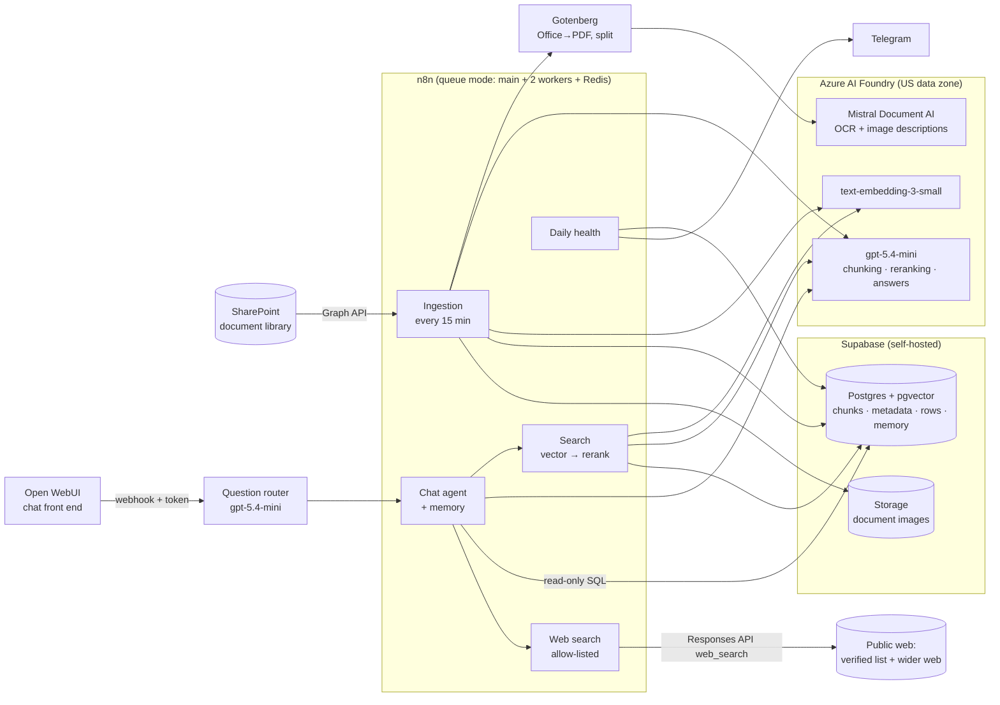

# Private RAG for SharePoint, built with n8n

A self-hosted "chat with your documents" assistant for a SharePoint document library.
Ask a question in a ChatGPT-style window; get an answer grounded in your own files, with the
source cited and, for how-to questions, the relevant screenshots from the documents shown inline.

- **Your data stays in your stack:** documents, vectors, chats and images live in your own Postgres
  (Supabase) — only the AI calls leave, to Azure AI Foundry in a US data zone (no training on your data).
- **Keeps itself in sync:** every 15 minutes it compares SharePoint with what it has indexed and
  processes only what's new, changed, renamed or deleted.
- **Reads everything:** PDFs, Word, PowerPoint (incl. scanned pages, via OCR), images inside documents
  (described by the OCR model so screenshots are searchable), photos with no text (described by a vision
  model), and spreadsheets (every tab of .xlsx/.xlsm) queried with SQL, not guessed from text.
- **Knows what's current — with three levels of trust:** when the documents don't cover it (current regulations,
  recent changes, best practices, products), it searches an **allow-list of authoritative public sites** and, when
  that isn't enough, the **wider web**. Answers keep three separate sections — **From your documents**, **From verified
  public sources**, **From the wider web — not on the verified list** — and the web sections are assembled by code
  from the sorted search results, so a source can never be relabelled. A **review mode** turns this into a gap
  report for any template, standard or checklist: what's covered, what to add, what may be outdated, with sources.
- **Built for operations:** queue-mode n8n, overlap guard, per-file retry, a run time limit that cancels a
  frozen run, fallbacks for files the converter rejects, a daily health message,
  90-day retention, a one-command right-to-erasure script, and usage counts that never store questions.

Based on the blueprint from the M365.FM podcast episode *"Building Private RAG: A Blueprint for SharePoint
& n8n"*, built end to end and hardened for real-world documents. Everything below is what actually runs.

## Architecture



### Ingestion (the `RAG – Ingestion` workflow)

| Step | What happens |
|---|---|
| ① Start & safety check | Runs every 15 min (set it to every 2 min by hand to clear a big backlog), 4 files per run; skips if another run is still going (asks n8n's own DB); 30-min time limit. |
| ② What's in SharePoint now | Lists the library through Microsoft Graph — the top level and every subfolder one level deep (folders named DNU / "Do Not Use" are skipped) — following `@odata.nextLink` pages. Files in a folder are named `Folder/File`. |
| ③ What changed | Compares against `document_metadata` using Graph's `quickXorHash` content fingerprint → new / updated / renamed-only / deleted / unchanged. Outdated files (`OLD_…`, "Do Not Use") count as absent. |
| ④ Batch & download | Takes 4 files, clears any half-finished data for them first (every run is idempotent). |
| ⑤ Spreadsheets → SQL | Rows from **every tab** (.xlsx/.xlsm; legacy .xls/.csv fall back to the first) go into `document_rows` as JSON (tab name in `_sheet`), so the agent can count and filter exactly. Zip archives of `.tbl` data tables are unzipped into rows the same way. |
| ⑥ Prepare for OCR | Gotenberg converts Office files to PDF and splits long PDFs into 10-page parts; a file it rejects goes to OCR whole. |
| ⑦ Read the pages | Mistral Document AI returns Markdown per page plus a description of every image. Photos with no text are described by gpt-5.4-mini instead. |
| ⑧ Images → Storage | Images are uploaded to Supabase Storage; links in the text point at them. |
| ⑨ Cut, embed, store | GPT proposes chunk boundaries over numbered paragraphs ("agentic chunking"); code validates and repairs the plan, merges tiny chunks, caps size. Chunks are embedded (1536-d) into pgvector. File metadata is written **last**, so a crash means "redo", never "half-indexed but marked done". |

### Answering (the `RAG – Chat agent`, `RAG – Search (reranked)` and `RAG – Web search (allow-listed)` workflows)

1. Open WebUI's **Knowledge Assistant** pipe forwards the newest message to an n8n webhook with a bearer
   token, labelling the memory session `<user-id>:<chat-id>`.
2. A usage row is written with **hashes only** (who/which chat, never the question).
3. A **question router** (one small gpt-5.4-mini call, JSON output) classifies the question — web needed: none /
   verified / verified + wider web, and whether it's a review request — and appends a per-question instruction to the
   agent's system message (for a documents-only question: "do not call the web tools"). The agent follows that far
   more reliably than a general rule in a long prompt, so plain how-to and spreadsheet questions stay on the documents.
4. A Tools Agent (gpt-5.4-mini) with Postgres chat memory decides which tools to call:
   - `search_documents` — vector search for 25 candidates → GPT reranks them and keeps up to 4
     (it may keep fewer). In side-by-side tests this beat plain vector order clearly: cover pages and
     duplicate copies of a deck stop crowding out the passage that actually answers the question.
   - `get_full_document` — every chunk of one file, in order, when a passage isn't enough.
   - `query_spreadsheets` — SQL over `document_rows`, through a **read-only** Postgres login
     with a 15-second timeout. The agent is told how form-style engineering sheets hide their headings in the
     first rows and how to skip blank template rows.
   - `search_web` — one call to the Azure OpenAI Responses API with its `web_search` tool, restricted to an
     allow-list of authoritative domains (edit it in the workflow; max 20). Used only for *current*
     regulations, recent changes or best practices, or when the documents don't answer.
   - `search_open_web` — the same tool without the domain filter, for products, newer approaches and anything the
     verified list doesn't cover. Every result bullet is sorted by its cited link: allow-listed → verified, anything
     else → wider web.
5. The model writes the documents part; an **Append web sections** code step then adds **From verified public
   sources** and **From the wider web — not on the verified list (use with caution)** exactly as the web tools sorted
   them (bullets and links verbatim). Conflicts with the documents are called out; the documents take precedence.
6. **Review mode** ("review this template against our standards and current regulations"): the agent reads the
   template in full, searches related internal standards, checks current regulations on the web, and returns a
   summary, what's covered, a prioritized table of recommended additions (every source marked doc or web),
   possibly outdated items and suggested wording.

### Privacy & operations

- **Row-level security** on every table; Supabase's public API sees nothing. The agent's login can only read.
- **Retention:** chat memory 90 days (pg_cron inside Postgres), Open WebUI chats 90 days (a sidecar
  container using Open WebUI's own delete code), logs 1 year.
- **Right to erasure:** `ops/forget-user.sh someone@example.com [--dry-run] [--delete-account]` removes a
  person's chats, agent memory, n8n run records and usage rows, and logs *that* it happened (hash + counts).
- **Web searches (verified and wider) send only a short, model-written search query** to the web search provider through Azure; the
  agent is instructed never to put document text, file names, project names or people in a query. Verified results come only from
  allow-listed domains (federal defaults plus any state or local sites you add); wider-web results can come from
  anywhere and are always labelled as not on the verified list.
- **Usage without surveillance:** active users and question counts from hashes, never question text.
- **Daily health message** (Telegram): documents, chunks, images, spreadsheets, last-24 h ingestion,
  files still failing, usage.
- **n8n hygiene:** ingestion and health runs are saved only when they fail; all executions are pruned after 72 h / 500 runs.

## Tech stack

| Component | Version | Role |
|---|---|---|
| n8n | 2.43.8 | Orchestration: ingestion, agent, tools. Queue mode (main + 2 workers) |
| Redis | 7.4 | Job queue between n8n main and workers |
| Postgres (n8n) | 17.6 | n8n's own workflows, credentials, run history |
| Supabase (self-hosted) | docker v0.8.3, Postgres 17.6 | pgvector (HNSW) store, metadata, spreadsheet rows, chat memory, Storage for images |
| Open WebUI | 0.12.3 | Chat front end, accounts, chat history |
| Gotenberg | 8.37.0 | LibreOffice conversion (PPTX/DOCX → PDF) and PDF splitting |
| Microsoft Graph | v1.0 | Reading the SharePoint library (delegated OAuth) |
| Azure OpenAI Responses API (`web_search` tool) | — | Allow-listed web search for current regulations and best practices |
| Telegram Bot API | — | Daily health message |

**Models** (Azure AI Foundry, Data Zone Standard US):

| Model | Used for |
|---|---|
| `mistral-document-ai-2512` | OCR: page text as Markdown + image descriptions |
| `text-embedding-3-small` (1536-d) | Embeddings for chunks and questions |
| `gpt-5.4-mini` | Agentic chunking, reranking, answering, web research summaries, describing photos with no text |

## What it costs (approximate, pay-as-you-go)

| | |
|---|---|
| Per question | ~$0.04 (agent + rerank calls) |
| Indexing a few-hundred-document library once | ~$15–30 (OCR with image descriptions dominates) |
| Hosting on the machine you already have | $0 |
| Hosting on a cloud VM (16 GB+ RAM, managed disk, backups) | ~$130–190 / month |

## Repository layout

```
n8n/workflows/        the four workflows, with placeholders (__SHAREPOINT_SITE_ID__ …) instead of real IDs
sql/                  database schema, the agent's read-only role, retention/usage/privacy tables
stack/n8n/            Docker Compose: n8n main + 2 workers + Redis + Postgres + Gotenberg
stack/open-webui/     Docker Compose: Open WebUI + retention sidecar
stack/supabase/       macOS override for Supabase Storage (named volume; see setup)
open-webui/           the Knowledge Assistant pipe function
ops/                  forget-user.sh (right to erasure)
scripts/              configure / sanitize workflows, leak check
docs/                 setup guide, lessons learned
```

## Getting started

See **[docs/setup.md](docs/setup.md)**. In short: start Supabase, n8n and Open WebUI with Docker Compose,
run the three SQL files, create the n8n credentials, fill `workflows.env`, run
`scripts/configure_workflows.py`, import and publish the workflows, paste the pipe into Open WebUI.

## Lessons learned

The build hit a long list of real-world problems — OCR page and size limits, a credential that silently
didn't attach, comma-splitting SQL parameters, 240 MB execution records, a stale browser tab that
overwrote a newer workflow, and more. They're collected, with fixes, in
**[docs/lessons-learned.md](docs/lessons-learned.md)**.

## Roadmap

- Share safely: HTTPS + company sign-in in front of Open WebUI; per-person document permissions
- Read-only SharePoint access scoped to one site (`Sites.Selected`)
- Signed (private) image links instead of a public bucket
- Meeting recordings: today transcribed locally (Whisper) and attached with `ops/ingest-transcript.py`; next, a transcription step inside the pipeline
- Skip duplicate documents (same deck as PDF and PPTX); spreadsheet header-row detection
- Honour Graph `Retry-After` exactly; a local cross-encoder reranker instead of GPT to cut cost per question
- Answer cache (reuse an answer while none of its cited documents changed); upload a template straight into chat for review mode

## Keeping it clean

The workflows are exported from a live instance, so `scripts/check-leaks.sh` runs before every commit and
refuses tenant names, IDs, e-mail addresses and secrets (plus a private deny list kept outside the repo).
Enable the hook once per clone:

```sh
git config core.hooksPath .githooks
```

## License

MIT — see [LICENSE](LICENSE).
